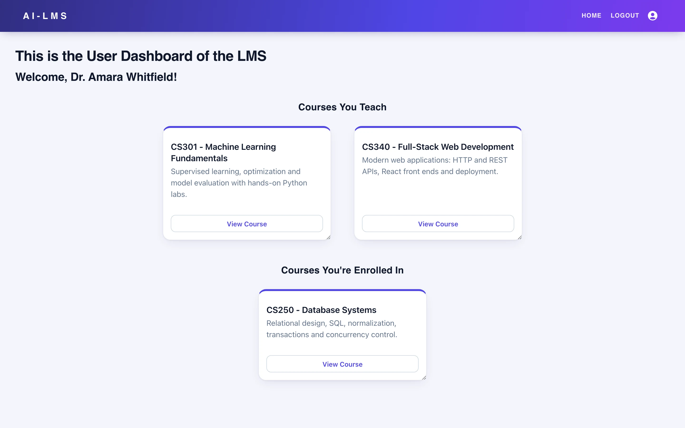
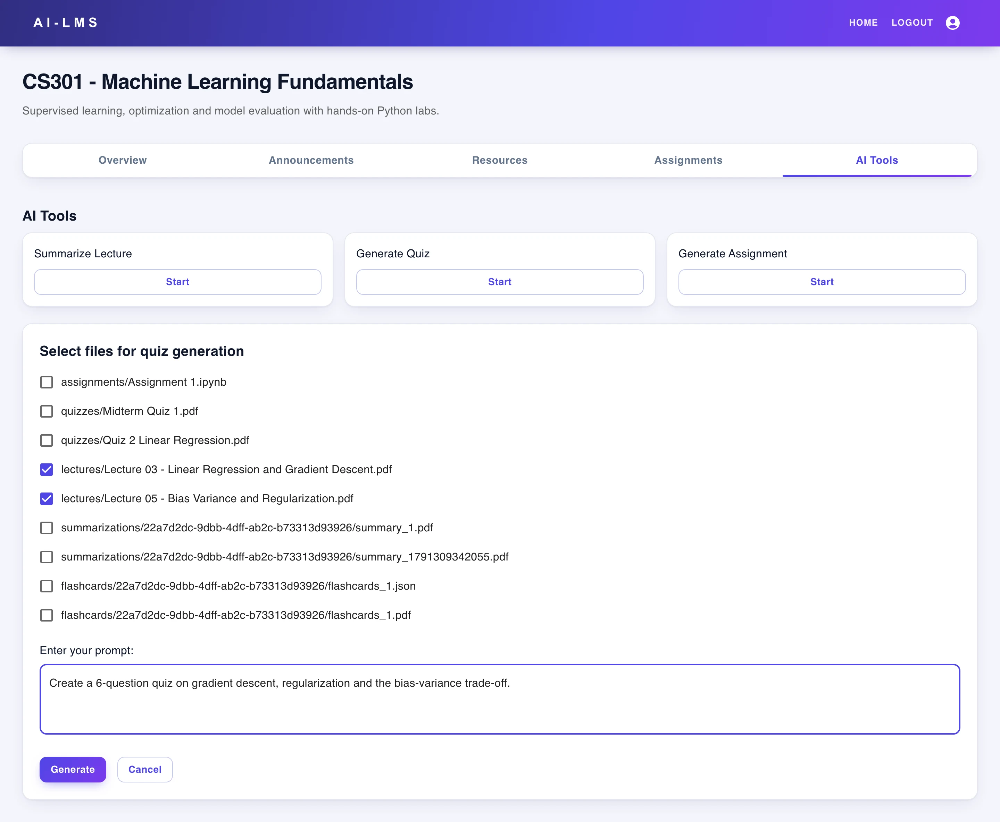
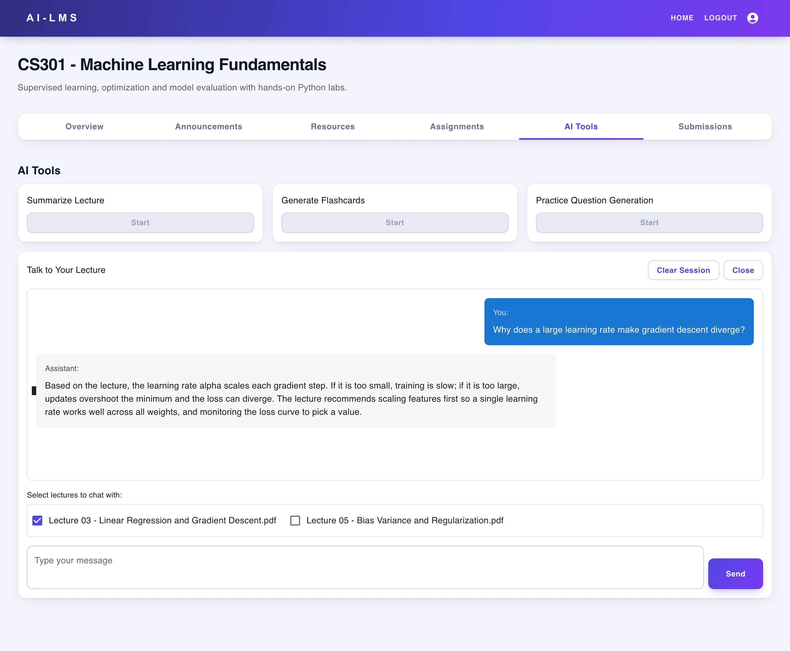
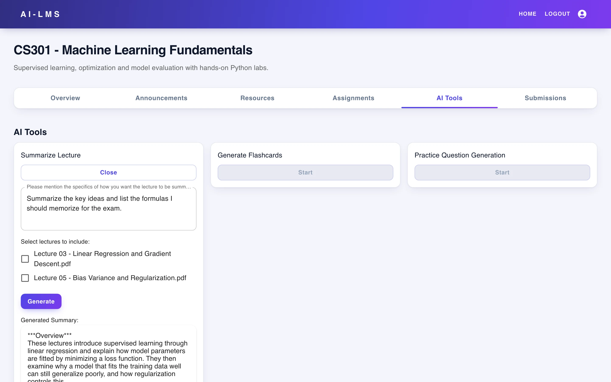
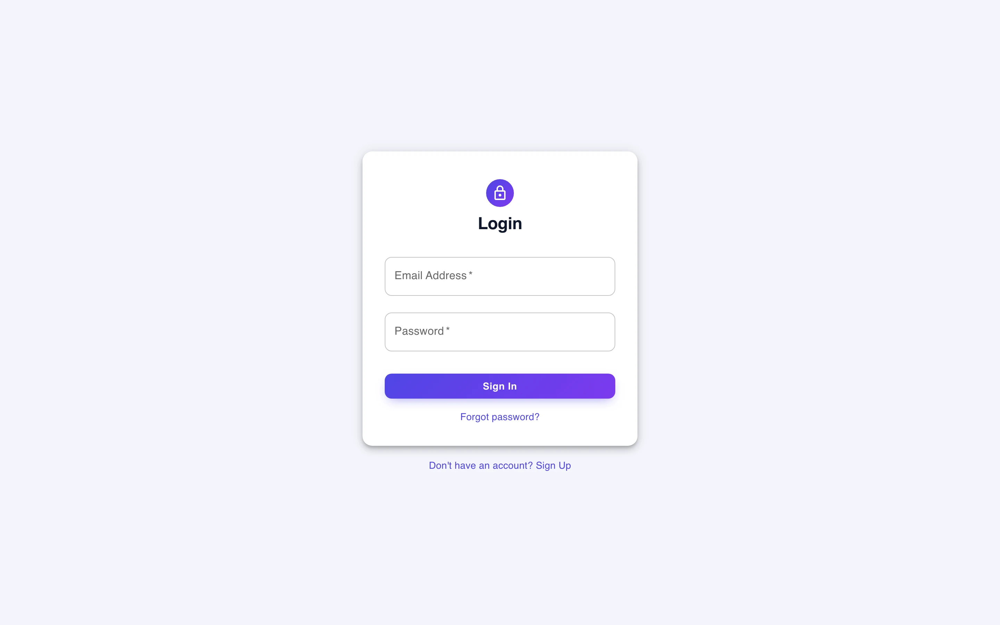
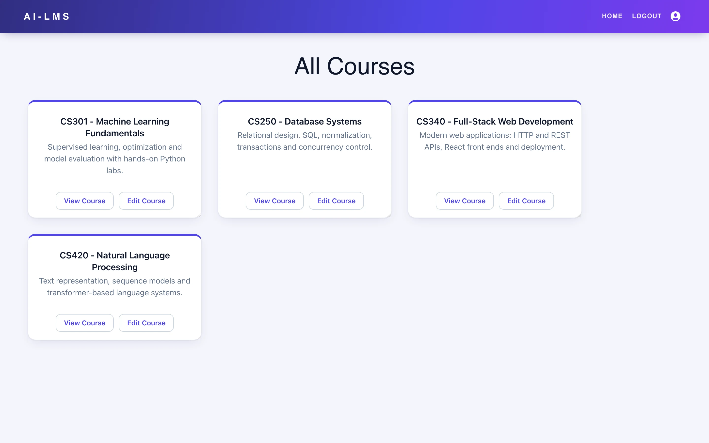
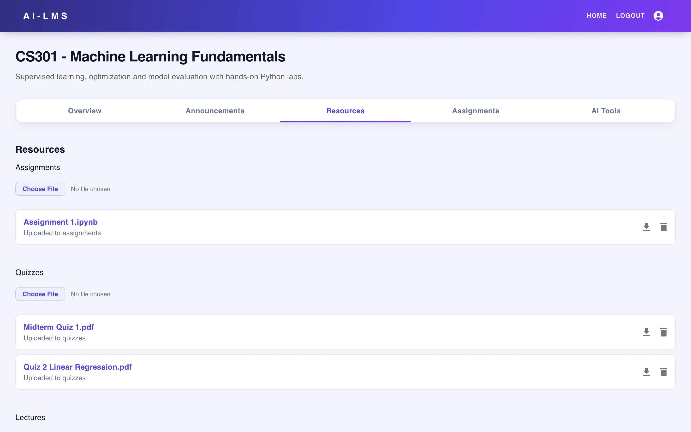
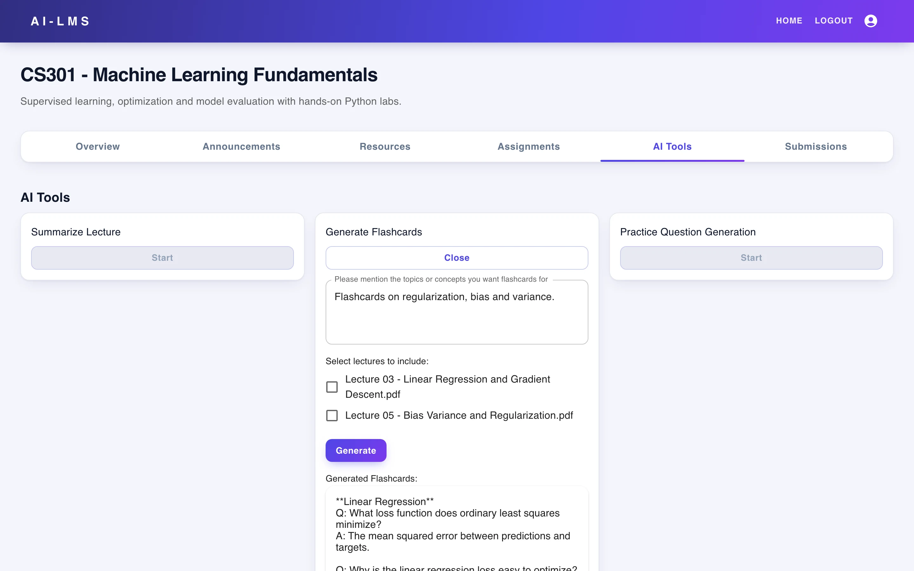
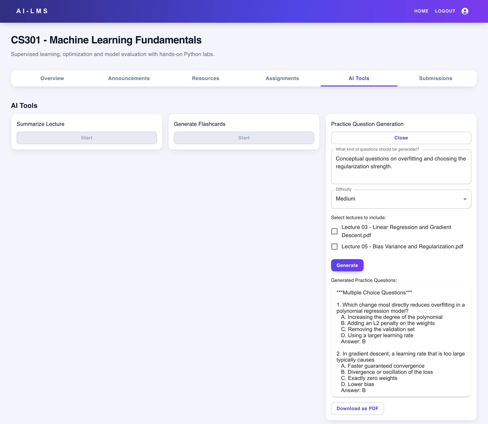

# AI-LMS

**A learning management system where instructors and students get AI tools grounded in the course's own material: quizzes, assignments, summaries, flashcards, practice questions and lecture chat.**

Next.js · React · FastAPI · LangGraph · Supabase · Llama models

<table>
  <tr>
    <td></td>
    <td></td>
  </tr>
  <tr>
    <td></td>
    <td></td>
  </tr>
</table>
Screenshots are real captures of a local build running on fictional demo data.

---

## Product at a Glance

| | |
|---|---|
| **What it is** | Web LMS with role-based dashboards and LLM-assisted teaching and study tools |
| **Users** | Admins, instructors and students (role is per course) |
| **AI tools** | Quiz and assignment generation with verification, lecture summaries, flashcards, practice questions, lecture chat |
| **Frontend** | Next.js 15, React 19, TypeScript, Material UI and MUI Joy |
| **Backend** | FastAPI, LangChain, LangGraph, sentence-transformers |
| **Data** | Supabase auth, Postgres, storage and pgvector search |
| **Models** | Llama 4 Maverick via OpenRouter; fine-tuned Llama-3-8B verifier on Together.ai |

## Product Showcase

<table>
  <tr>
    <td> Sign-in</td>
    <td> Admin course catalogue</td>
    <td> Course resources</td>
  </tr>
  <tr>
    <td> Flashcards from lectures</td>
    <td> Practice questions by difficulty</td>
    <td> Instructor quiz generator</td>
  </tr>
</table>

## Key Features

- Role-aware dashboards: admin course management, instructor and student views per course
- Course resource library with upload, download and delete by category
- Instructor tools: generate quizzes and assignments from selected files, review, give feedback and regenerate; export to PDF or notebook
- Student tools: lecture summaries, flashcards (PDF and JSON export), practice questions by difficulty, grounded lecture chat with history

## Architecture

A Next.js client with middleware-guarded routes and server actions talks to a FastAPI service. The service embeds and chunks uploaded documents, retrieves context with hybrid text and vector search in Supabase, and runs LangGraph workflows that call hosted language models. See [docs/ARCHITECTURE.md](docs/ARCHITECTURE.md).

## Engineering Highlights

- LangGraph generate-verify-regenerate pipelines with instructor feedback in the loop
- Retrieval scoped to the documents the user selects, with LLM query rewriting and hybrid keyword and vector search
- Locally run embedding model for document and chunk vectors
- LoRA fine-tuned Llama-3-8B verifier with fallback to the base model
- One Next.js app serving admin, instructor and student roles, with PDF and notebook export

## Status & Scope

- The demo build runs on seeded fictional data. Hosted Supabase and hosted LLM endpoints are replaced locally by stand-ins.
- Real in the demo: application code, document chunking and embedding, retrieval ranking, LangGraph control flow, exports and UI.
- Scripted in the demo: the language-model text responses.
- Placeholder in this version: Overview, Announcements and Assignments tab content.

## Documentation

- [Product overview](docs/PRODUCT_OVERVIEW.md)
- [Architecture](docs/ARCHITECTURE.md)
- [Technical case study](docs/TECHNICAL_CASE_STUDY.md)
- [Engineering challenges](docs/ENGINEERING_CHALLENGES.md)
- [Privacy and source](docs/PRIVACY_AND_SOURCE.md)

## Rights

Production source is private; see [RIGHTS.md](RIGHTS.md).
