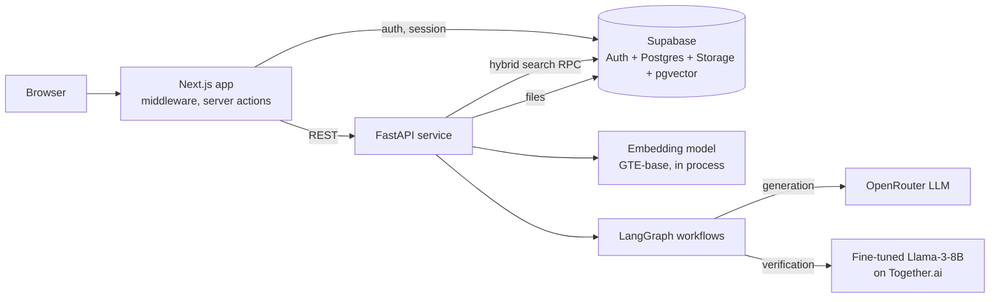

# Architecture

AI-LMS is a three-part system: a Next.js web client, a FastAPI service that hosts the AI workflows, and Supabase for authentication, relational data, file storage and vector search. Hosted language models are called from the FastAPI service.

## Components

**Frontend.** Next.js App Router with TypeScript, React, Material UI and MUI Joy. Middleware redirects unauthenticated users; server actions call the backend. Role determines which dashboard and course view is shown.

**Backend.** FastAPI routers for auth, courses, generation and summarisation. A storage manager loads PDFs, splits them into chunks, embeds them with a sentence-transformer model and writes document and chunk embeddings to Supabase.

**Retrieval.** A query is rewritten by an LLM, embedded, and used in a hybrid text-plus-vector search through a Supabase RPC, restricted to the documents the user selected.

**Workflows (LangGraph).**
- Assignment and quiz: retrieval, meta-prompt, generation, verification, then conversion to notebook or PDF. Conditional edges support regeneration and instructor feedback.
- Practice questions: contextualised prompt, retrieval, generation.
- Summarisation, flashcards and chat are separate endpoints; chat keeps message history.

**Models.** Generation uses a Llama 4 Maverick model through OpenRouter. Verification uses a LoRA fine-tuned Llama-3-8B hosted on Together.ai, with fallback to the base model if it returns nothing.

## Demo build

The demo replaces hosted Supabase and the hosted LLM endpoints with local stand-ins. Embedding, chunking, retrieval ranking, workflow control flow and export are the real code; model text outputs are scripted.
